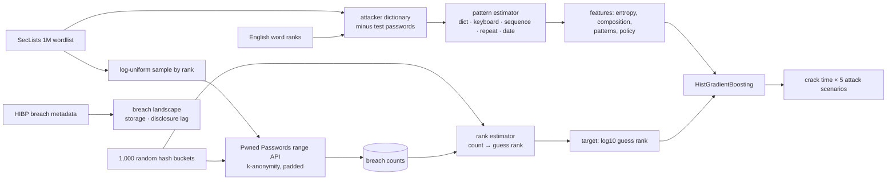
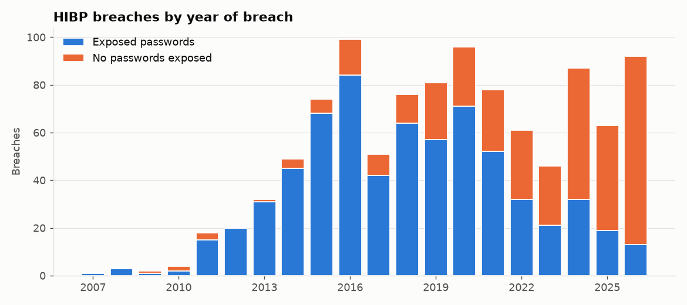
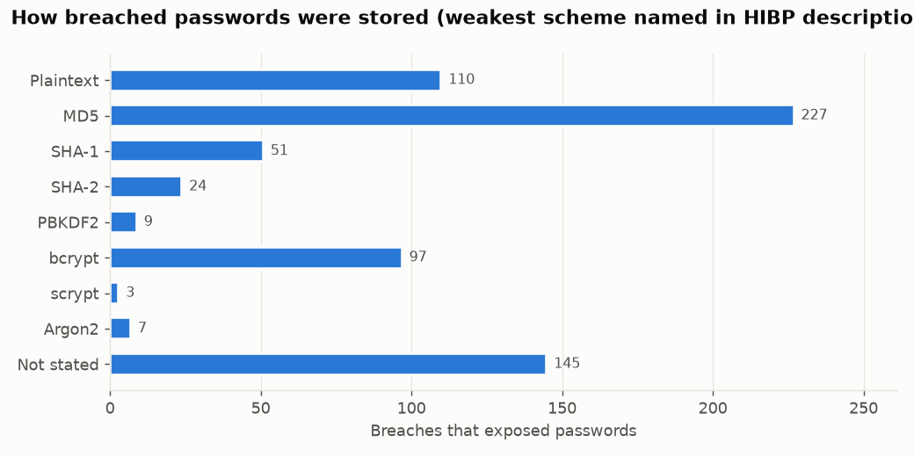
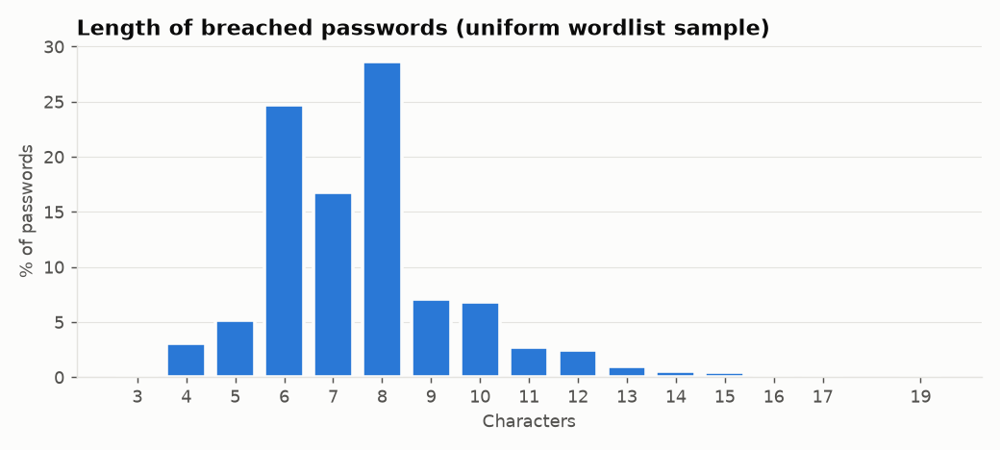
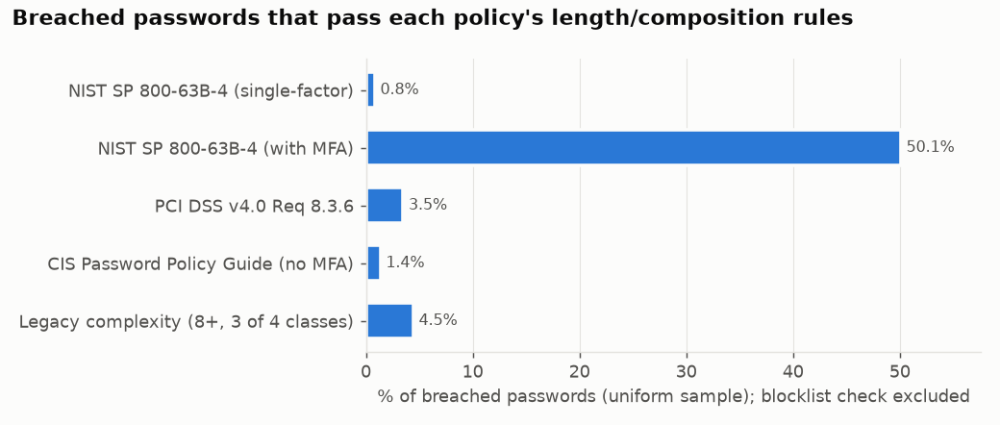
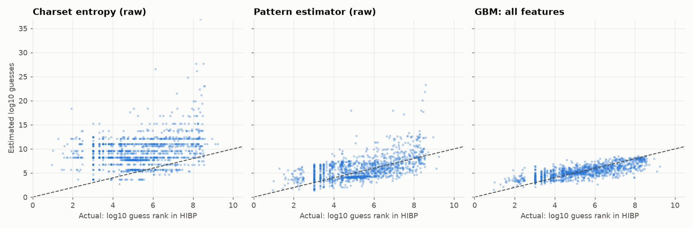
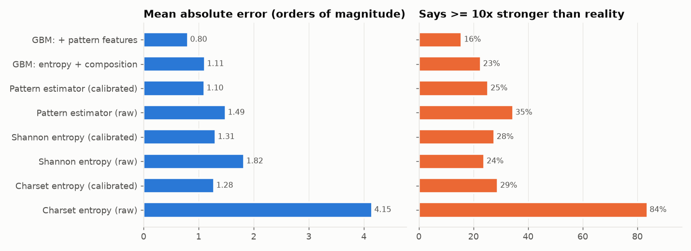
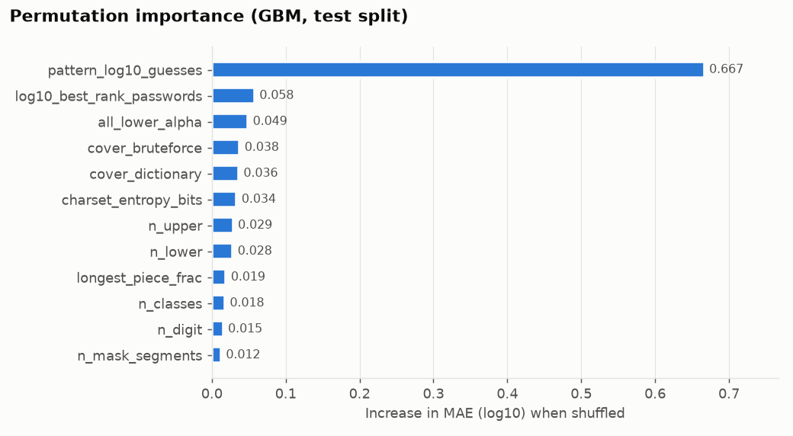

# Password Breach & Strength Analysis

An analysis of **HaveIBeenPwned** breach data, plus a model that estimates how long a password takes
to crack from its **entropy**, the **common patterns** in it, and its **password-policy compliance**.

Most strength meters and composition policies treat strength as `length × log2(character pool)`.
Attackers don't guess uniformly, though. They replay breach corpora in order of popularity, then
apply words, keyboard walks, dates and l33t rules. This project measures the gap between those two
views on real breach data and builds an estimator grounded in what attackers actually do.

## What it does

1. **Breach landscape.** Pulls HIBP's public breach list (~1,000 breaches) and analyses how many exposed
   passwords, how long disclosure took, and how the passwords were stored (plaintext, MD5, SHA-1,
   bcrypt and so on, parsed from each breach description).
2. **Real breach frequencies.** Looks up a sample of plaintext passwords from a public 1M wordlist in
   **Pwned Passwords** through the k-anonymity range API. Only 5 hex characters of each SHA-1 hash
   leave the machine, and response padding is on.
3. **Guess rank, not just a count.** Downloads 1,000 random hash buckets in full (an unbiased sample
   of the ~1B-hash corpus) and turns each password's breach count into its **guess rank**: how many
   guesses an attacker replaying the corpus in frequency order needs before reaching it.
4. **Pattern-aware estimator.** A from-scratch implementation of the zxcvbn guess model: ranked
   dictionaries with case, l33t and reversal variants, QWERTY keyboard walks, sequences, repeats
   and dates, combined by dynamic programming into the cheapest decomposition.
5. **Crack-time model.** Gradient-boosted regression on entropy, composition, pattern and policy
   features, predicting log10(guess rank). It is compared against raw and calibrated entropy and
   against the pattern estimator alone. Guesses become crack times for five attack scenarios, from
   a throttled online login to offline NTLM on a GPU.
6. **Policy compliance.** Checks NIST SP 800-63B-4, PCI DSS v4.0, CIS and legacy "8 characters,
   3 of 4 classes" rules, and measures how many *already-breached* passwords each policy allows.
7. **`pwcheck` CLI.** Scores one password: breach count, guess estimate, crack-time table, policy
   compliance and advice. It never prints, logs or passes the password on the command line.



## Results

<!-- RESULTS:START -->
_Generated by `python -m pwanalysis.report`; every number comes from `outputs/summary.json` and `outputs/metrics.json`._

### Data collected

* **1,052 breaches** in HIBP's public breach list (19 fabricated or spam lists excluded from the stats below).
* **6,939 wordlist passwords** looked up in Pwned Passwords via the k-anonymity API (6,000 sampled log-uniformly by wordlist rank + 939 found in random buckets); **6,936** are in the corpus.
* **1,000 random hash buckets** (1,971,786 hashes) sampled to estimate the corpus size (**~2.07 billion distinct passwords**) and each password's guess rank.

### Breach landscape (HIBP metadata)

* 65.2% of real breaches (673 of 1033) exposed passwords, covering 11.04 billion account records.
* Where HIBP's description says how passwords were stored (528 breaches), **78.0% were plaintext or a fast hash** (MD5 / SHA-1 / SHA-2): 110 plaintext, 227 MD5, 51 SHA-1, against 97 bcrypt.
* Median time from breach to appearing in HIBP: **132 days** (237 for breaches with passwords); 34.7% surfaced more than a year later.





### How breached passwords are built

Uniform sample: 945 wordlist passwords, of which 99.7% are in Pwned Passwords; median length of the breached ones is 8.

| Pattern | Share of breached passwords |
|---|---:|
| contains a dictionary/leaked word | 69.1% |
| ends in digits | 47.7% |
| all lowercase letters | 37.9% |
| all digits | 15.2% |
| contains a year (1900-2039) | 7.1% |
| repeated characters/blocks | 6.4% |
| l33t substitution | 4.6% |
| capitalised first letter only | 3.8% |
| keyboard walk | 3.3% |
| character sequence (abc, 123) | 3.2% |

Top hashcat-style masks (u=upper, l=lower, d=digit, s=symbol): `llllllll` 10.1%, `llllll` 7.9%, `dddddd` 7.6%, `lllllll` 6.4%, `lllllllll` 3.3%, `lllllldd` 3.2%



### Password policy vs. reality

Pass rate from the uniform sample; median rank and crack share from all breached passwords that pass (log-uniform sample, larger n). With a breach blocklist, every one of these would be rejected.

| Policy | Breached passwords that pass its length/composition rules | Median guess rank of those | Cracked in < 1 day, offline bcrypt | Has breach blocklist |
|---|---:|---:|---:|:---:|
| NIST SP 800-63B-4 (single-factor) | 0.8% | 152,834,525 | 100.0% | yes |
| NIST SP 800-63B-4 (with MFA) | 50.1% | 318,767 | 99.3% | yes |
| PCI DSS v4.0 Req 8.3.6 | 3.5% | 130,226,323 | 92.0% | no |
| CIS Password Policy Guide (no MFA) | 1.4% | 139,036,385 | 100.0% | yes |
| Legacy complexity (8+, 3 of 4 classes) | 4.5% | 61,349,601 | 95.9% | no |

Most common breached passwords that satisfy legacy complexity rules: `Abcd1234`, `7uGd5HIp2J`, `Q1w2e3r4t5y6`, `Mustang1`, `Soso123aljg`.



### Crack time for breached passwords

Uniform sample of breached passwords, using each one's empirical guess rank (an attacker replaying the corpus in frequency order):

| Scenario | Cracked within 1 second | Cracked within 1 day |
|---|---:|---:|
| Online, throttled (100 guesses/hour) | 0.0% | 0.2% |
| Online, unthrottled (10 guesses/s) | 0.0% | 17.8% |
| Offline bcrypt cost 10, 1 GPU | 0.5% | 99.0% |
| Offline unsalted SHA-1, 1 GPU | 100.0% | 100.0% |
| Offline NTLM, 1 GPU | 100.0% | 100.0% |

| Password | Times in HIBP | Guess rank | Charset 'entropy' | Online throttled | Offline bcrypt |
|---|---:|---:|---:|---|---|
| `123456` | 210,463,629 | 1 | 20 bits | 36 seconds | instant (< 1 second) |
| `password` | 52,373,976 | 4 | 38 bits | 2 minutes | instant (< 1 second) |
| `qwerty` | 30,813,001 | 7 | 28 bits | 4 minutes | instant (< 1 second) |
| `iloveyou` | 7,007,939 | 20 | 38 bits | 12 minutes | instant (< 1 second) |
| `dragon` | 4,415,386 | 31 | 28 bits | 19 minutes | instant (< 1 second) |
| `letmein` | 1,406,641 | 121 | 33 bits | 1 hour | instant (< 1 second) |

### Crack-time model

Target: log10 guess rank of 6,936 breached passwords (train 5,548 / test 1,388). Test-split results:

| Estimator | Spearman ρ | MAE (orders of magnitude) | Within 10x | Says >= 10x too strong |
|---|---:|---:|---:|---:|
| Charset entropy (raw) | 0.230 | 4.15 | 13.3% | 83.6% |
| Charset entropy (calibrated) | 0.230 | 1.28 | 45.5% | 29.0% |
| Shannon entropy (raw) | 0.203 | 1.82 | 35.2% | 24.0% |
| Shannon entropy (calibrated) | 0.201 | 1.31 | 46.0% | 27.7% |
| Pattern estimator (raw) | 0.567 | 1.49 | 45.4% | 34.5% |
| Pattern estimator (calibrated) | 0.567 | 1.10 | 50.9% | 25.4% |
| GBM: entropy + composition | 0.452 | 1.11 | 54.8% | 22.7% |
| GBM: + pattern features | 0.747 | 0.80 | 68.5% | 15.7% |

* Raw charset entropy overstates breached passwords by a median **10^3.9x** (10^8.3x for ones that pass legacy complexity rules) and calls 83.6% of them at least 10x stronger than they are.
* The pattern estimator alone cuts that to 34.5% (Spearman 0.57); the gradient-boosted model reaches Spearman **0.75**, MAE **0.80** orders of magnitude, 68.5% within 10x of the true rank.
* Most important features: `pattern_log10_guesses`, `log10_best_rank_passwords`, `all_lower_alpha`, `cover_bruteforce`, `cover_dictionary`.







<!-- RESULTS:END -->

## Method notes

**Ground truth.** For a breached password, the target is its *empirical guess rank*. If `N(c)` is
the number of distinct corpus passwords seen at least `c` times, then a password seen `c` times sits
at rank ≈ `N(c)` under an optimal frequency-ordered attack. `N(c)` is estimated from the random
buckets, scaled by 16⁵ / buckets sampled, because SHA-1 prefixes spread hashes uniformly across
buckets. The head of the distribution (counts in the millions) never shows up in random buckets, so
there the exact order of the looked-up passwords is used as a lower bound (`rank.py`). Resolution:
each sampled hash stands for ~1,048 corpus hashes, so ranks between the known head and ~10³ are
coarse. That is the vertical striping near log10 rank 3 in the scatter plots.

**Leakage control.** The wordlist rank and the breach count are the same popularity signal as the
target, so neither is a feature. The attacker dictionary is the full wordlist **minus the test
passwords**, and no password is ever matched against its own exact entry (`exclude_exact`), so
training and test passwords are featurised the same way. Without that rule the model learns to
look passwords up, and its test score collapses on unseen ones. The blocklist part of policy
compliance is excluded for the same reason.

**Sampling.** Candidates are sampled log-uniformly by wordlist rank so the very common head and the
long tail are both represented. Population statistics (pattern prevalence, policy pass rates,
masks) use only the passwords whose hash fell in a *random* bucket: a uniform sample of the wordlist.

**Attack rates** (`config.yaml`): 100 guesses/hour (throttled online), 10/s (unthrottled online),
and rounded single-GPU hashcat benchmark figures for bcrypt cost 10, SHA-1 and NTLM. They are
order-of-magnitude settings. Change them in the config and re-run `make report`.

## Limitations

* **Population.** The plaintext sample comes from one public wordlist, so results describe passwords
  that are already common enough to be listed there. They are not a random sample of all user
  passwords.
* **Ranks above the corpus.** Passwords absent from Pwned Passwords have no measured rank, only a
  lower bound (the corpus size). The model is trained on breached passwords, so for strong unseen
  passwords `pwcheck` falls back to the larger of the corpus size and the pattern estimate.
* **Storage parsing.** Storage schemes come from HIBP's free-text descriptions. Not every description
  says, and a breach naming several schemes is classed by the weakest one.
* **Disclosure lag.** Recent breach years are right-censored: breaches from 2025–2026 that will be
  disclosed later are not in the data yet, which pulls their median lag down.
* **Estimator.** The pattern estimator is a simplified zxcvbn (one keyboard layout, two dictionaries,
  no name or surname lists). Real cracking rules (hashcat `best64`, PRINCE, Markov) are stronger
  still, so all estimates are upper bounds on safety, not guarantees.

## Usage

```bash
make venv        # .venv with pinned deps, package installed editable
make data        # wordlists + breach metadata + ~7,000 k-anonymity lookups (cached, resumable)
make train       # fit + evaluate models → outputs/metrics.json, models/
make report      # analysis, figures, outputs/report.md, refresh the README results
make test        # offline unit tests (make test-network for the live HIBP test)
make check       # pwcheck: score a password interactively
```

```bash
.venv/bin/pwcheck              # prompts, nothing echoed
.venv/bin/pwcheck --offline    # no network call at all
.venv/bin/pwcheck --json
```

## Project layout

```
src/pwanalysis/
  hibp.py        Pwned Passwords k-anonymity client (padding, retries) + breach metadata
  dataset.py     downloads, log-uniform sampling, cached bucket lookups
  rank.py        breach count → attacker guess rank
  patterns.py    dictionary / l33t / keyboard / sequence / repeat / date matchers
  estimator.py   entropy measures + zxcvbn-style minimum-guess decomposition
  features.py    model features (no leakage columns)
  policy.py      NIST / PCI / CIS / legacy compliance checks
  crack_time.py  guesses → time per attack scenario
  train.py       baselines, gradient boosting, permutation importance
  breaches.py    breach landscape + password-storage parsing
  report.py      figures, summary.json, report.md, README results
  cli.py         pwcheck
```

## Data and ethics

* **HIBP Pwned Passwords** and the **breach list** are public APIs from Troy Hunt (CC BY 4.0). Only
  hash prefixes are sent. The project never handles email addresses or account data.
* **SecLists** `xato-net-10-million-passwords-1000000.txt` (MIT) is a public research wordlist;
  **google-10000-english** is used for English word ranks (research use).
* Downloaded data lives in `data/` and is git-ignored. Nothing is redistributed.
* This is a defensive tool for policy design and user education. It does not crack hashes.

## License

MIT
