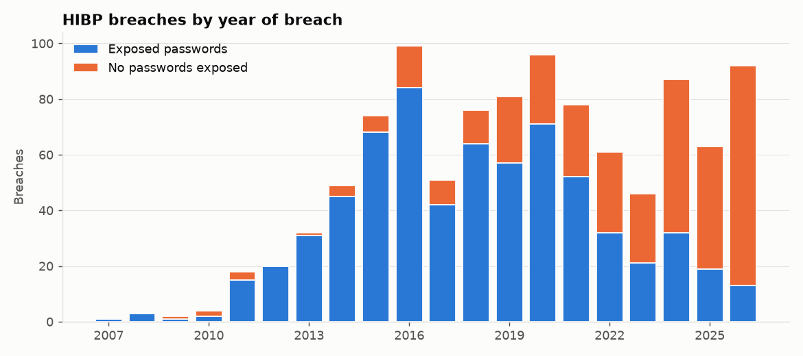
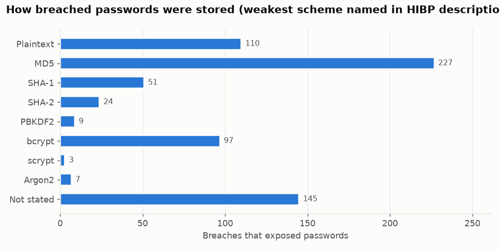
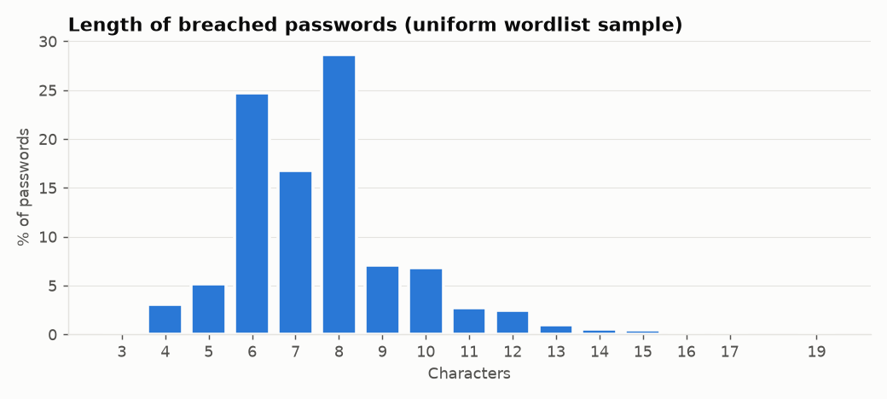
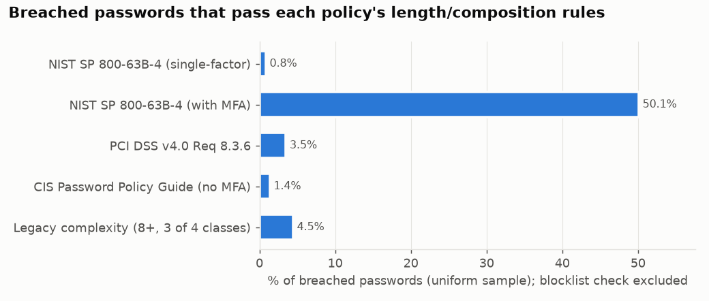
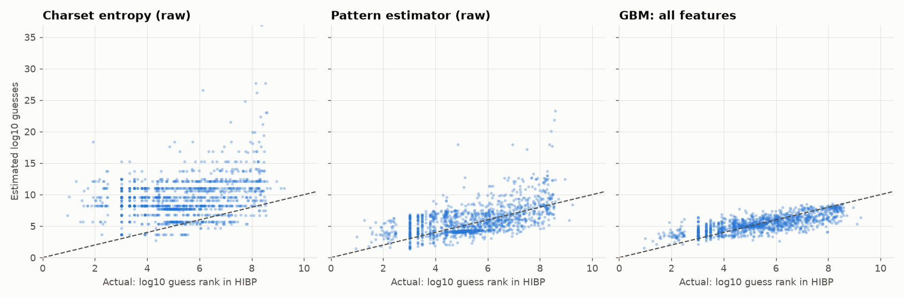
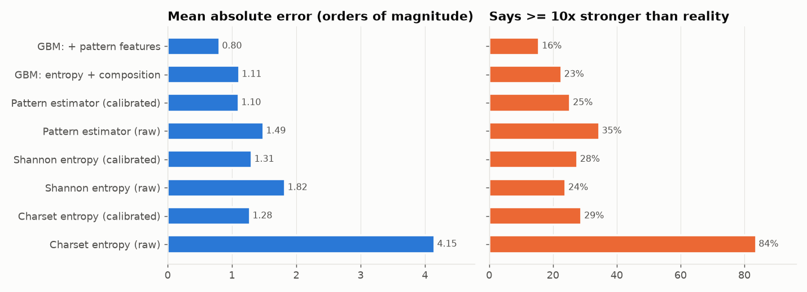
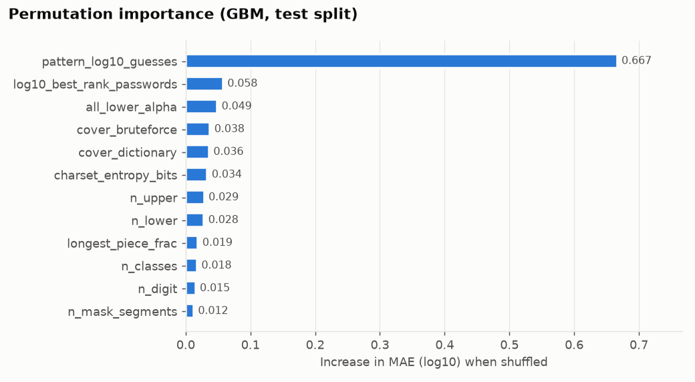

# Password Breach & Strength Analysis: results

_Generated by `python -m pwanalysis.report`; every number comes from `outputs/summary.json` and `outputs/metrics.json`._

### Data collected

* **1,052 breaches** in HIBP's public breach list (19 fabricated or spam lists excluded from the stats below).
* **6,939 wordlist passwords** looked up in Pwned Passwords via the k-anonymity API (6,000 sampled log-uniformly by wordlist rank + 939 found in random buckets); **6,936** are in the corpus.
* **1,000 random hash buckets** (1,971,786 hashes) sampled to estimate the corpus size (**~2.07 billion distinct passwords**) and each password's guess rank.

### Breach landscape (HIBP metadata)

* 65.2% of real breaches (673 of 1033) exposed passwords, covering 11.04 billion account records.
* Where HIBP's description says how passwords were stored (528 breaches), **78.0% were plaintext or a fast hash** (MD5 / SHA-1 / SHA-2): 110 plaintext, 227 MD5, 51 SHA-1, against 97 bcrypt.
* Median time from breach to appearing in HIBP: **132 days** (237 for breaches with passwords); 34.7% surfaced more than a year later.

### How breached passwords are built

Uniform sample: 945 wordlist passwords, of which 99.7% are in Pwned Passwords; median length of the breached ones is 8.

| Pattern | Share of breached passwords |
|---|---:|
| contains a dictionary/leaked word | 69.1% |
| ends in digits | 47.7% |
| all lowercase letters | 37.9% |
| all digits | 15.2% |
| contains a year (1900-2039) | 7.1% |
| repeated characters/blocks | 6.4% |
| l33t substitution | 4.6% |
| capitalised first letter only | 3.8% |
| keyboard walk | 3.3% |
| character sequence (abc, 123) | 3.2% |

Top hashcat-style masks (u=upper, l=lower, d=digit, s=symbol): `llllllll` 10.1%, `llllll` 7.9%, `dddddd` 7.6%, `lllllll` 6.4%, `lllllllll` 3.3%, `lllllldd` 3.2%

### Password policy vs. reality

Pass rate from the uniform sample; median rank and crack share from all breached passwords that pass (log-uniform sample, larger n). With a breach blocklist, every one of these would be rejected.

| Policy | Breached passwords that pass its length/composition rules | Median guess rank of those | Cracked in < 1 day, offline bcrypt | Has breach blocklist |
|---|---:|---:|---:|:---:|
| NIST SP 800-63B-4 (single-factor) | 0.8% | 152,834,525 | 100.0% | yes |
| NIST SP 800-63B-4 (with MFA) | 50.1% | 318,767 | 99.3% | yes |
| PCI DSS v4.0 Req 8.3.6 | 3.5% | 130,226,323 | 92.0% | no |
| CIS Password Policy Guide (no MFA) | 1.4% | 139,036,385 | 100.0% | yes |
| Legacy complexity (8+, 3 of 4 classes) | 4.5% | 61,349,601 | 95.9% | no |

Most common breached passwords that satisfy legacy complexity rules: `Abcd1234`, `7uGd5HIp2J`, `Q1w2e3r4t5y6`, `Mustang1`, `Soso123aljg`.

### Crack time for breached passwords

Uniform sample of breached passwords, using each one's empirical guess rank (an attacker replaying the corpus in frequency order):

| Scenario | Cracked within 1 second | Cracked within 1 day |
|---|---:|---:|
| Online, throttled (100 guesses/hour) | 0.0% | 0.2% |
| Online, unthrottled (10 guesses/s) | 0.0% | 17.8% |
| Offline bcrypt cost 10, 1 GPU | 0.5% | 99.0% |
| Offline unsalted SHA-1, 1 GPU | 100.0% | 100.0% |
| Offline NTLM, 1 GPU | 100.0% | 100.0% |

| Password | Times in HIBP | Guess rank | Charset 'entropy' | Online throttled | Offline bcrypt |
|---|---:|---:|---:|---|---|
| `123456` | 210,463,629 | 1 | 20 bits | 36 seconds | instant (< 1 second) |
| `password` | 52,373,976 | 4 | 38 bits | 2 minutes | instant (< 1 second) |
| `qwerty` | 30,813,001 | 7 | 28 bits | 4 minutes | instant (< 1 second) |
| `iloveyou` | 7,007,939 | 20 | 38 bits | 12 minutes | instant (< 1 second) |
| `dragon` | 4,415,386 | 31 | 28 bits | 19 minutes | instant (< 1 second) |
| `letmein` | 1,406,641 | 121 | 33 bits | 1 hour | instant (< 1 second) |

### Crack-time model

Target: log10 guess rank of 6,936 breached passwords (train 5,548 / test 1,388). Test-split results:

| Estimator | Spearman ρ | MAE (orders of magnitude) | Within 10x | Says >= 10x too strong |
|---|---:|---:|---:|---:|
| Charset entropy (raw) | 0.230 | 4.15 | 13.3% | 83.6% |
| Charset entropy (calibrated) | 0.230 | 1.28 | 45.5% | 29.0% |
| Shannon entropy (raw) | 0.203 | 1.82 | 35.2% | 24.0% |
| Shannon entropy (calibrated) | 0.201 | 1.31 | 46.0% | 27.7% |
| Pattern estimator (raw) | 0.567 | 1.49 | 45.4% | 34.5% |
| Pattern estimator (calibrated) | 0.567 | 1.10 | 50.9% | 25.4% |
| GBM: entropy + composition | 0.452 | 1.11 | 54.8% | 22.7% |
| GBM: + pattern features | 0.747 | 0.80 | 68.5% | 15.7% |

* Raw charset entropy overstates breached passwords by a median **10^3.9x** (10^8.3x for ones that pass legacy complexity rules) and calls 83.6% of them at least 10x stronger than they are.
* The pattern estimator alone cuts that to 34.5% (Spearman 0.57); the gradient-boosted model reaches Spearman **0.75**, MAE **0.80** orders of magnitude, 68.5% within 10x of the true rank.
* Most important features: `pattern_log10_guesses`, `log10_best_rank_passwords`, `all_lower_alpha`, `cover_bruteforce`, `cover_dictionary`.

